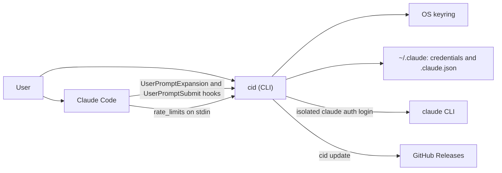
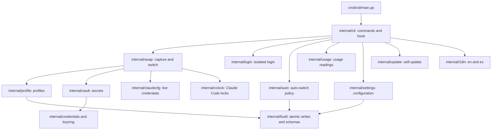
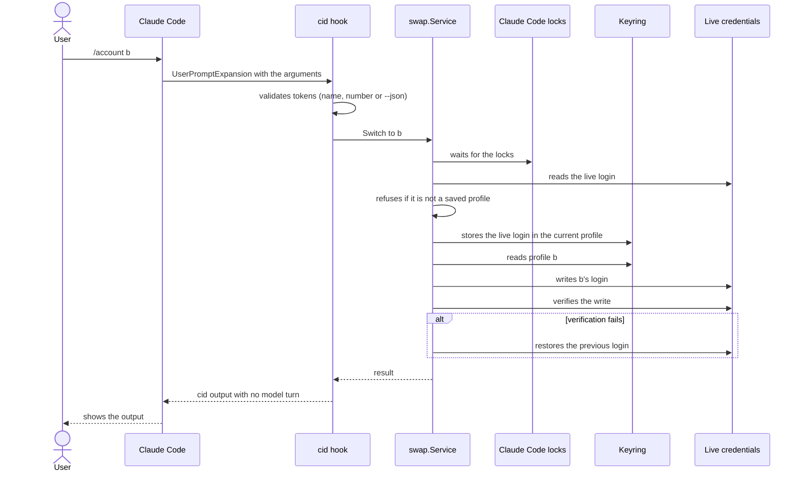

# claude-identity architecture

English · [Español](./architecture.md)

`cid` is a Go binary (module `github.com/nicoarbelaez/claude-identity`, Go 1.26.0) plus a Claude Code plugin. The binary stores accounts in the OS keyring and replaces Claude Code's active login; the plugin connects those operations to the session through hooks.

## Context



## Components



## Main flow: hot-swapping an account



## Data flow

- **Profiles:** `profiles.json` (name, email, index and active marker) in the user's config directory. Secrets are not there: they live in the keyring.
- **Live account:** credentials and `oauthAccount` in `~/.claude` and `~/.claude.json`, or the `Claude Code-credentials` Keychain item on macOS.
- **Usage:** `cid statusline` reads `rate_limits` from the status line's standard input and stores the numbers for the active account. It makes no network call.
- **Auto-switch:** the status line evaluates the policy and leaves a pending switch in a state file; the `UserPromptSubmit` hook applies it before the next message.
- **Validated files:** `profiles.json`, `config.json` and the `auto` files are validated against JSON Schema on read.

## Folder structure

```text
cmd/cid/main.go        entry point
internal/
  cli/                 commands, hook, statusline, update, uninstall
  swap/                capture, switch and relogin
  claudecfg/ credentials/ vault/   reading and writing credentials and keyring
  profile/ settings/   profiles and configuration with file recovery
  auto/                auto-switch policy, state and configuration
  login/ usage/ update/ cclock/ pathenv/ fsutil/ i18n/ version/
plugin/                hooks and the `account` skill
.claude-plugin/        marketplace.json
scripts/               install.ps1 and install.sh
docs/                  RELEASING.md, spikes/r2-hot-swap.md and this documentation
```

## Key decisions

- **Replace in place instead of multiple directories.** A single `~/.claude` keeps history and the session; only the identity changes. An experiment backing this is in `docs/spikes/r2-hot-swap.md`.
- **No OAuth of its own.** Account setup delegates to `claude auth login` in a temporary directory, and `cid` never calls Anthropic.
- **OS keyring for secrets.** Windows Credential Manager, macOS Keychain or Linux Secret Service, through `go-keyring`.
- **Switching safety.** Claude Code's locks are respected, writes are atomic with `rename` (with a Windows variant), file locking uses `flock`, and a post-write check triggers rollback.
- **Shell-free hook.** The plugin calls `cid hook` in exec form and validates tokens, so user arguments never reach a shell. The reply is shown with no model turn.
- **Policy with anti-flap rules.** Auto-switch needs 5 points of headroom and 5 minutes between switches, and does not depend on the network.
- **Stable contract.** `--json` and exit codes 0, 1 and 2 are the interface for scripts.
- **Verifiable delivery.** Installers with SHA-256 and `gh attestation verify`, cross-platform GoReleaser, release-please, CI with the race detector on three operating systems and actions pinned by SHA.
