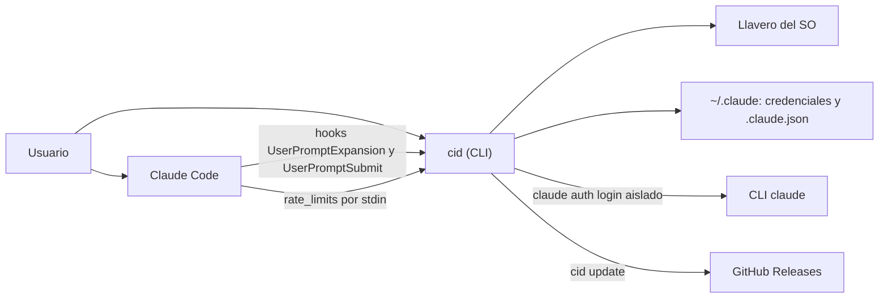
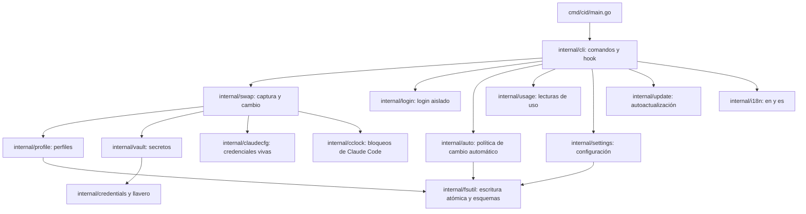
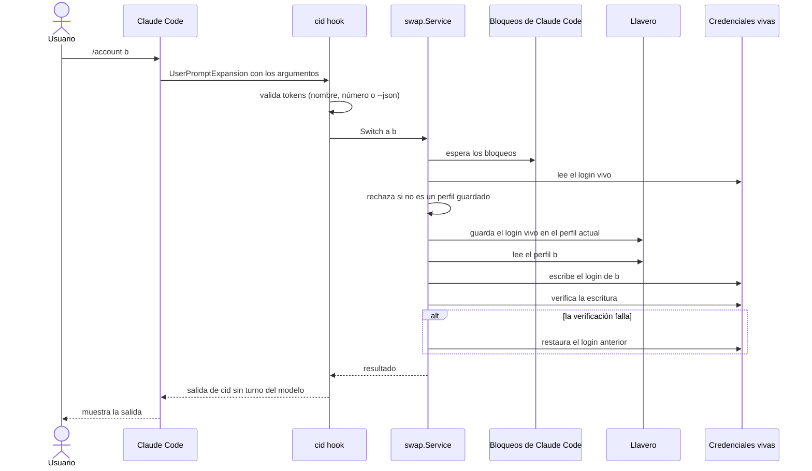

# Arquitectura de claude-identity

[English](./architecture.en.md) · Español

`cid` es un binario Go (módulo `github.com/nicoarbelaez/claude-identity`, Go 1.26.0) más un plugin de Claude Code. El binario guarda cuentas en el llavero del sistema y reemplaza el inicio de sesión activo de Claude Code; el plugin conecta esas operaciones con la sesión mediante hooks.

## Contexto



## Componentes



## Flujo principal: cambio de cuenta en caliente



## Flujo de datos

- **Perfiles:** `profiles.json` (nombre, correo, índice y marca de activo) en el directorio de configuración del usuario. Los secretos no están ahí: viven en el llavero.
- **Cuenta viva:** credenciales y `oauthAccount` en `~/.claude` y `~/.claude.json`, o el elemento `Claude Code-credentials` de Keychain en macOS.
- **Uso:** `cid statusline` lee `rate_limits` de la entrada estándar de la línea de estado y guarda las cifras de la cuenta activa. No usa la red.
- **Cambio automático:** la línea de estado evalúa la política y deja un cambio pendiente en un archivo de estado; el hook `UserPromptSubmit` lo aplica antes del siguiente mensaje.
- **Archivos validados:** `profiles.json`, `config.json` y los archivos de `auto` se validan con JSON Schema al leerse.

## Estructura de carpetas

```text
cmd/cid/main.go        punto de entrada
internal/
  cli/                 comandos, hook, statusline, update, uninstall
  swap/                captura, cambio y relogin
  claudecfg/ credentials/ vault/   lectura y escritura de credenciales y llavero
  profile/ settings/   perfiles y configuración con recuperación de archivos
  auto/                política, estado y configuración del cambio automático
  login/ usage/ update/ cclock/ pathenv/ fsutil/ i18n/ version/
plugin/                hooks y skill `account`
.claude-plugin/        marketplace.json
scripts/               install.ps1 e install.sh
docs/                  RELEASING.md, spikes/r2-hot-swap.md y esta documentación
```

## Decisiones clave

- **Reemplazar en el sitio en vez de varios directorios.** Un solo `~/.claude` mantiene el historial y la sesión; solo cambia la identidad. Hay un experimento que lo valida en `docs/spikes/r2-hot-swap.md`.
- **Sin OAuth propio.** El alta de cuentas delega en `claude auth login` dentro de un directorio temporal, y `cid` nunca llama a Anthropic.
- **Llavero del sistema para secretos.** Windows Credential Manager, macOS Keychain o Linux Secret Service, mediante `go-keyring`.
- **Seguridad del cambio.** Bloqueos de Claude Code respetados, escritura atómica con `rename` (con variante para Windows), bloqueo de archivo con `flock`, verificación posterior y reversión.
- **Hook sin shell.** El plugin invoca `cid hook` en forma exec y valida los tokens, así que los argumentos del usuario no llegan a un shell. La respuesta se muestra sin turno del modelo.
- **Política con anti-oscilación.** El cambio automático exige 5 puntos de margen y 5 minutos entre cambios, y no depende de la red.
- **Contrato estable.** `--json` y los códigos de salida 0, 1 y 2 son la interfaz para scripts.
- **Entrega verificable.** Instaladores con SHA-256 y `gh attestation verify`, GoReleaser multiplataforma, release-please, CI con detector de carreras en tres sistemas y acciones fijadas por SHA.
